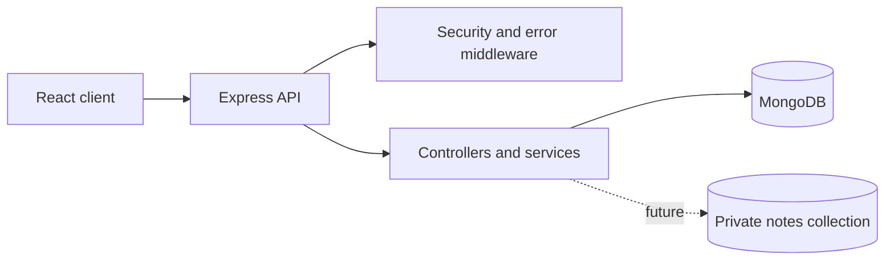

# TherapySession Admin

Privacy-first appointment administration for counsellors. The application stores scheduling metadata and pseudonymous client codes only; it is not an EHR.

## Current phase

Phase 3 adds appointment scheduling metadata, availability, aggregate statistics, and admin user management. Private notes remain separate and are added in a later phase.

## Phase 1 setup

1. Install Node.js 20 or newer and MongoDB.
2. Copy `server/.env.example` to `server/.env`.
3. Replace all placeholder secrets with random values. `NOTES_ENCRYPTION_KEY` must be base64 for exactly 32 decoded bytes, and access/refresh secrets must differ. Run `npm run generate:secrets` to generate them.
4. Install dependencies:

   ```powershell
   cd "server"
   npm install
   ```

5. Start MongoDB, then run:

   ```powershell
   npm run dev
   ```

6. Verify the health endpoint:

   ```powershell
   curl.exe http://localhost:4000/healthz
   ```

Expected response:

```json
{ "status": "ok" }
```

Readiness returns `200 {"status":"ready"}` only when Mongoose is connected; otherwise it returns `503 {"status":"not_ready"}`.

## Authentication API

All endpoints are under `/api/v1/auth`.

| Method | Endpoint    | Access             | Purpose                                                              |
| ------ | ----------- | ------------------ | -------------------------------------------------------------------- |
| POST   | `/login`    | Public             | Returns a 15-minute access token and sets the rotated refresh cookie |
| POST   | `/refresh`  | Public with cookie | Rotates the refresh token and detects reuse                          |
| POST   | `/logout`   | Public with cookie | Revokes the current refresh token                                    |
| GET    | `/me`       | Authenticated      | Returns the current non-sensitive user profile                       |
| POST   | `/register` | Admin              | Creates a counsellor; passwords are bcrypt-hashed with cost 12       |

Send the returned access token as `Authorization: Bearer <token>`. Refresh cookies are `httpOnly`, `SameSite=Strict`, scoped to `/api/v1/auth`, and `Secure` in production.

## Scheduling and administration API

All endpoints require a bearer access token unless stated otherwise.

| Method | Endpoint                              | Access           | Purpose                                                                                                  |
| ------ | ------------------------------------- | ---------------- | -------------------------------------------------------------------------------------------------------- |
| POST   | `/api/v1/appointments`                | Counsellor/admin | Create a pseudonymous appointment; admins must provide `counsellorId`                                    |
| GET    | `/api/v1/appointments`                | Counsellor/admin | Filtered, paginated scheduling metadata; counsellors see only their own                                  |
| GET    | `/api/v1/appointments/:id`            | Counsellor/admin | Read one appointment; cross-counsellor access returns 404                                                |
| PATCH  | `/api/v1/appointments/:id`            | Owner/admin      | Reschedule using an atomic overlap check; status remains `scheduled` and reschedule metadata is updated  |
| PATCH  | `/api/v1/appointments/:id/attendance` | Owner/admin      | Record attendance only after the appointment starts                                                      |
| DELETE | `/api/v1/appointments/:id`            | Owner/admin      | Soft-cancel; within 24 hours records `late-cancel`                                                       |
| GET    | `/api/v1/availability`                | Counsellor/admin | Free 15-minute slots inside configured business hours                                                    |
| GET    | `/api/v1/stats`                       | Counsellor/admin | Aggregate totals, completed-session attendance/no-show rates, cancellation counts, and sessions per week |
| GET    | `/api/v1/users`                       | Admin            | Paginated staff list without password or lock fields                                                     |
| PATCH  | `/api/v1/users/:id/deactivate`        | Admin            | Deactivate a staff account and revoke all refresh tokens                                                 |

Appointments use UTC dates on the wire and are validated against `WORK_START_HOUR`, `WORK_END_HOUR`, and `WORK_TZ`. Rescheduling keeps status `scheduled` and records `rescheduledAt` plus `rescheduleCount`. The API uses MongoDB transactions plus a per-counsellor booking-version lock for double-booking protection, so production MongoDB must run as a replica set or use MongoDB Atlas.

### Data minimisation

Scheduling stores only a counsellor reference, pseudonymous `clientCode`, time, session type, status, and attendance. It never accepts or stores client names, phone numbers, emails, addresses, diagnoses, dates of birth, notes, or free text.

## Privacy & Security Design

- `User` stores only staff identity and authentication data required for administration.
- `RefreshToken` stores only a SHA-256 token hash, family metadata, expiry, and revocation state; raw refresh tokens exist only in the secure cookie.
- `AuditLog` stores actor, action, resource, IP, and timestamp. It does not store client codes, notes, or clinical/identifying data.
- Access tokens are short-lived JWTs kept by clients in memory. Deactivated users are checked on every authenticated request.
- Five failed logins lock an account for 15 minutes. Login errors are generic, and unknown-email attempts perform a dummy bcrypt comparison.
- Login and refresh are limited to 10 requests per 15 minutes; the general API limiter is separate.
- Validation and persistence errors are normalized into stable JSON error codes without production stack traces.

## Architecture



Later phases will add the models, authentication, appointment routes, private-note isolation, and client application.
