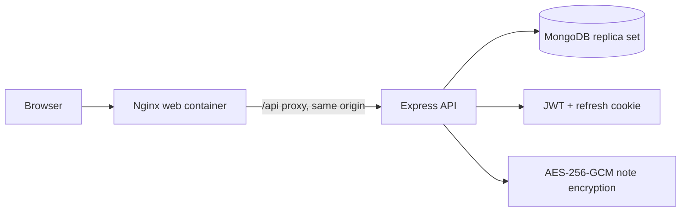
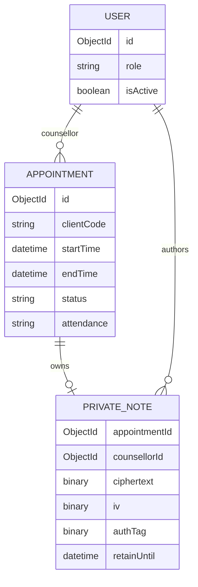

# TherapySession Admin

Privacy-first appointment administration for counsellors and administrators. The
application uses pseudonymous client codes and keeps private clinical notes
separate from scheduling metadata.


## Features

- In-memory access-token authentication with rotating, httpOnly refresh cookies.
- Counsellor-owned appointment scheduling, availability, attendance, and notes.
- Admin statistics, counsellor filtering, user administration, and deactivation.
- Encrypted private notes with retention, ownership checks, no-store responses,
  auto-locking, and no client identifiers beyond `CL-XXXX` codes.
- Responsive, keyboard-navigable React client with loading, empty, retry, and
  toast feedback states.

## Architecture



## Data model



Appointment metadata never contains names, phone numbers, emails, or clinical
content. Private notes are stored separately and encrypted at rest.

## Tech stack

- React, Vite, React Router, TanStack Query, React Hook Form, Zod, Tailwind CSS.
- Node.js 20, Express, MongoDB/Mongoose, JWT, bcrypt, Pino.
- Docker Compose, Nginx, GitHub Actions, Husky, lint-staged.

## Quick start with Docker

```powershell
Copy-Item .env.example .env
# Replace every placeholder with generated values:
node server/scripts/generate-secrets.js
docker compose up --build
```

The web application is available at `http://localhost:8080`. Only the web port
is published. MongoDB runs as a single-node replica set because appointment
booking uses transactions.

Seed development users after the stack is running:

```powershell
docker compose run --rm api node scripts/seed.js
```

The seed command requires the seed passwords in `.env`.

## Local development

```powershell
Copy-Item server\.env.example server\.env
cd server
npm ci
npm run dev

cd ..\client
npm ci
npm run dev
```

For local development, run MongoDB with a replica set and set
`MONGODB_URI` accordingly. The client defaults to `/api/v1`; set
`VITE_API_BASE_URL` when the API is hosted elsewhere.

## Environment variables

| Variable                            |  Required | Purpose                                   |
| ----------------------------------- | --------: | ----------------------------------------- |
| `NODE_ENV`                          |       yes | `development`, `test`, or `production`    |
| `MONGODB_URI`                       |       yes | MongoDB URI including `replicaSet=rs0`    |
| `CORS_ORIGIN`                       |       yes | Exact browser origin; HTTPS in production |
| `TRUST_PROXY`                       |       yes | Required as `true` in production          |
| `ACCESS_TOKEN_SECRET`               |       yes | Access JWT signing secret                 |
| `REFRESH_TOKEN_SECRET`              |       yes | Refresh JWT signing secret                |
| `NOTES_ENCRYPTION_KEY`              |       yes | Base64-encoded 32-byte AES key            |
| `NOTES_ENCRYPTION_KEYS`             |        no | JSON key-version map for rotation         |
| `NOTES_ENCRYPTION_CURRENT_VERSION`  |        no | Current note key version                  |
| `NOTE_RETENTION_DAYS`               |        no | Note retention period                     |
| `WORK_START_HOUR` / `WORK_END_HOUR` |        no | Business hours                            |
| `WORK_TZ`                           |        no | Availability business timezone            |
| `ADMIN_SEED_PASSWORD`               | seed only | Initial admin password                    |
| `COUNSELLOR_*_SEED_PASSWORD`        | seed only | Initial counsellor passwords              |

Use `node server/scripts/generate-secrets.js` to generate production secrets.
Never commit `.env` files.

## API reference

The non-production API publishes the hand-written OpenAPI document at
`GET /api/docs`. Health endpoints are available at `/healthz` and `/readyz`.

| Method             | Path                                  | Purpose                                       |
| ------------------ | ------------------------------------- | --------------------------------------------- |
| `POST`             | `/api/v1/auth/login`                  | Login and set refresh cookie                  |
| `POST`             | `/api/v1/auth/refresh`                | Rotate refresh cookie and return access token |
| `POST`             | `/api/v1/auth/logout`                 | Revoke refresh token                          |
| `GET`              | `/api/v1/auth/me`                     | Current user                                  |
| `POST`             | `/api/v1/auth/register`               | Admin creates counsellor                      |
| `GET/POST`         | `/api/v1/appointments`                | List or book metadata                         |
| `GET/PATCH/DELETE` | `/api/v1/appointments/:id`            | Read, reschedule, or cancel                   |
| `PATCH`            | `/api/v1/appointments/:id/attendance` | Record attendance                             |
| `GET/PUT/DELETE`   | `/api/v1/appointments/:id/note`       | Owner-only private note                       |
| `GET`              | `/api/v1/availability`                | Available contiguous 15-minute slots          |
| `GET`              | `/api/v1/stats`                       | Counsellor or admin statistics                |
| `GET`              | `/api/v1/users`                       | Admin user list                               |
| `PATCH`            | `/api/v1/users/:id/deactivate`        | Admin deactivation                            |

Example booking:

```json
{
  "clientCode": "CL-AB12",
  "startTime": "2026-11-02T10:00:00.000Z",
  "endTime": "2026-11-02T11:00:00.000Z",
  "sessionType": "online"
}
```

Errors use `{ "status": 400, "code": "VALIDATION_ERROR", "message": "...", "details": [] }`.

## Privacy and security

The client uses only pseudonymous client codes. Access tokens never enter
browser storage. Notes are encrypted with AES-256-GCM, AAD-bound to the
appointment and author, and excluded from lists, statistics, logs, and URLs.
See the full review in [SECURITY.md](./SECURITY.md).

## Threat model

We defend against unauthorized counsellor-to-counsellor access, leaked browser
storage, accidental clinical-data collection, replayed refresh tokens, malformed
requests, brute-force login, and common browser transport/header attacks.
Residual risks include environment-managed keys instead of KMS, no MFA,
single-region deployment, and operational dependence on a single MongoDB node.

## Testing

```powershell
cd server; npm run lint; npm test
cd ..\client; npm run lint; npm test; npm run build
docker compose config
```

CI repeats lint, tests, client build, dependency audits, secret scanning, and
Docker image builds.

## Project structure

```text
client/       React/Vite application, API hooks, feature screens and tests
server/       Express API, services, schemas, models and tests
.github/      CI and Dependabot configuration
docker-compose.yml
SECURITY.md
```

## Roadmap

1. Operational deployment with managed MongoDB replica sets and KMS-backed key
   management.
2. MFA and centralized identity provider integration.
3. Observability dashboards and controlled disaster recovery exercises.
