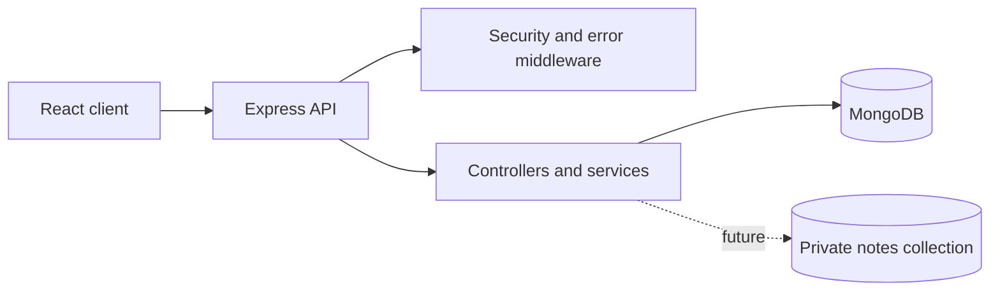

# TherapySession Admin

Privacy-first appointment administration for counsellors. The application stores scheduling metadata and pseudonymous client codes only; it is not an EHR.

## Current phase

Phase 1 establishes the Node.js/Express API scaffold, validated environment configuration, MongoDB connection lifecycle, baseline security middleware, health check, and consistent error responses. Feature routes and models are added in later phases.

## Phase 1 setup

1. Install Node.js 20 or newer and MongoDB.
2. Copy `server/.env.example` to `server/.env`.
3. Replace all placeholder secrets with random values. `NOTES_ENCRYPTION_KEY` must be configured as a secret suitable for the encryption implementation in Phase 4.
4. Install dependencies:

   ```powershell
   cd "server"
   npm install
   ```

5. Start MongoDB, then run:

   ```powershell
   npm run dev
   ```

6. Verify the health endpoint:

   ```powershell
   curl.exe http://localhost:4000/healthz
   ```

Expected response:

```json
{"status":"ok"}
```

## Architecture



Later phases will add the models, authentication, appointment routes, private-note isolation, and client application.
